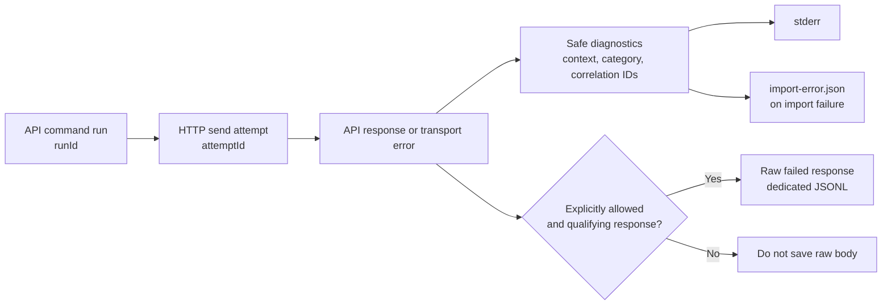
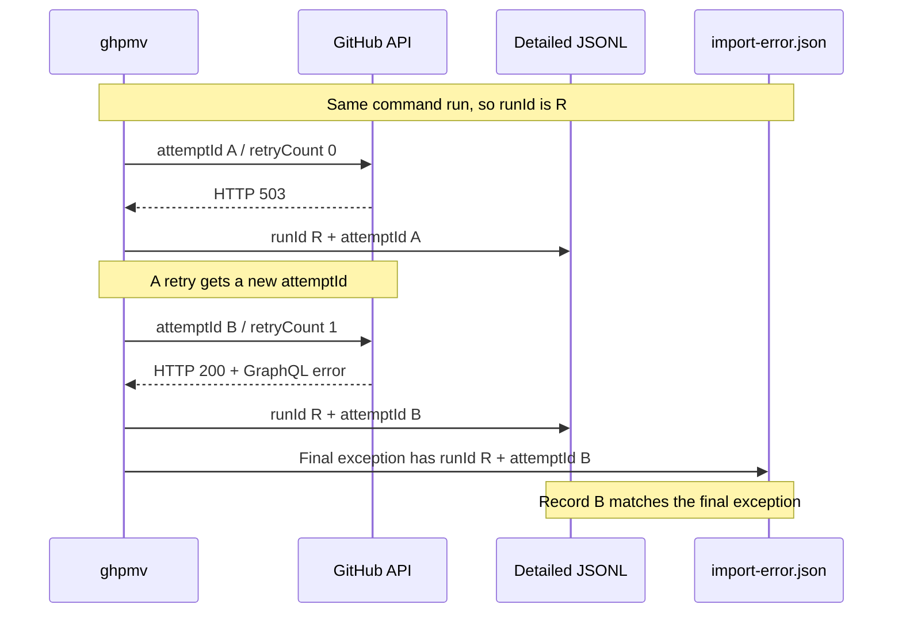

# Logging and diagnostics

[README](../README.md) | [Migration scope](MIGRATION_SCOPE.md) | [Manual test plan](MANUAL_TEST_PLAN.md)

Use `ghpmv` logs to identify which migration failed, what failed, and which API response to inspect if needed.

> **Safe API diagnostics are not anonymized logs.**
> Normal diagnostics retain Organization, Repository, Project, and element names and known IDs. Review them before sharing. Raw API responses require even more careful handling.

## Where to start

| Question | Where to look |
| --- | --- |
| Which Organization, Project, or element failed? | `source` / `target` / `element` on stderr; `context` in the report |
| Which application build produced the stack trace? | `application.version`, `application.commitSha`, and `application.isDirty` in `import-error.json` |
| What stage, HTTP status, and error category? | `stage`, `operation`, and safe diagnostics in `exceptions[]` |
| Was it the original failure or a cleanup failure? | `exceptions[]` versus `cleanupFailures[]` |
| Do I need the raw API response? | The dedicated JSONL created with explicit permission; it is not in the normal report |
| How do I match a report to JSONL? | Use **the exception's own `runId` + `attemptId`** |
| Is it safe to rerun? | See [Recovery and resume](#recovery-and-resume); in particular, do not automatically resend an ambiguous creation |

- [Outputs and retention](#outputs-and-retention)
- [Failure context and normal reports](#failure-context-and-normal-reports)
- [Capturing raw API responses explicitly](#capturing-raw-api-responses-explicitly)
- [Correlating diagnostics](#correlating-diagnostics)
- [Capture states](#capture-states)
- [Redaction and size limits](#redaction-and-size-limits)
- [Recovery and resume](#recovery-and-resume)
- [Implementation and tests](#implementation-and-tests)

## Outputs and retention

**Diagnostic reports, resume-state files, and migration data serve different purposes.**

| Output | Location and creation condition | Purpose | Retention and cautions |
| --- | --- | --- | --- |
| stdout | Standard output of each command | Results such as URLs, `result=...`, and counts | Preserves the existing machine-readable format; never mixes in raw response bodies for diagnostics |
| stderr | Standard error of each command | Progress, warnings, errors, and output locations | Shell or CI retention is managed separately. Normal API diagnostics are redacted but contain business identifiers |
| `import-error.json` | Import snapshot directory, on failure | Cause, affected target, correlation IDs, and cleanup failures | Replaced by a later failure in the same directory; a successful run with no warnings or unresolved state deletes the previous report |
| `resume-state.db` | Import snapshot directory, committed before/after remote operations | **Authoritative** Project, Field, View, Item and Status Update resume state | Retain with the snapshot and mappings; never delete to force a retry. Contains business data and pending operations |
| `project-import-log.json` | Import snapshot directory, exported at import finalization | Diagnostic projection of Project, Field, View, etc. state | Marked with DB revision and generation time; may be stale. Only supported legacy files are migration inputs on first use |
| `import-log.json` | Import snapshot directory, exported at import finalization | Diagnostic projection of Item and Status Update state | Contains business data and error fields; not a backup or a substitute for the database |
| `ghpmv-sensitive-api-<unique-id>.jsonl` | **Working directory at execution time**, when explicitly allowed and a qualifying response exists | Raw failed API responses | Separate file per run; no automatic deletion or encryption. Review before sharing |
| `snapshot.json` / mapping CSV | Export destination or user-specified location | Migration data and mappings | Not logs; may contain bodies and values, so do not assume the protections of diagnostic logs |
| Verify JSON report | Location specified by `--report-json` | Differences in migration results | Different format from `import-error.json`; differences may contain business data |
| HTML report | Item/project reports after successful or failed `import`; `import-error.html` on failure; beside `verify --report-json`; or an explicit `report` output | Read-only analysis of a committed DB snapshot or supported JSON output | Includes the complete input; review before sharing. Does not replace SQLite resume state. Automatic reports overwrite the previous report; `import-error.html` is deleted with `import-error.json`. Disable HTML only with `--no-html-report` |

An earlier `import-error.json` may remain after a skip or a run that finishes with warnings. **Do not infer that this run failed merely because the file exists; check its `runId` and timestamp.** If writing the report fails, retain the stderr error as well.

Command-line syntax and option-validation errors occur before import starts and do not create a report. A failure before the snapshot is loaded records only the known target and stage.



## Failure context and normal reports

### Identifying the affected target

`context` contains identifiers available at the point of failure; it is not inferred from the last progress message. Known identifiers are recorded in the report, exceptions, progress entries, and cleanup failures.

| Field | Description |
| --- | --- |
| `context.source` / `context.target` | Owner, owner type, API host, and Project number, title, and known ID |
| `context.element` | Kind, name, type, and known ID of a Field, View, Workflow, etc. |
| `context.item` | Parent Item for operations such as updating an Item's Field; Issues and PRs are identified by Repository and number |
| `context.operation` | Migration or API operation; retains names such as `preflight-linked-team` even when a Query fails |
| `context.stage` | Stage such as `preflight`, `importing-project`, or `importing-items` |
| `exceptions[].operationKind` | `query` / `mutation`, REST operation kind, etc.; distinct from the migration operation name |

New exports record the source in the optional `source` property of `snapshot.json`. Older snapshots still load, but missing owner, number, and host information is not inferred from mappings. `--project-title` changes the intended target title, not the recorded source title.

Target numbers and IDs are recorded once resolved. An explicitly requested number is also retained in `requestedTargetProjectNumber`. An existing Project's title is omitted if it has not yet been read; target IDs are not invented for Fields or Items that have not been created.

Issues and PRs are identified by Repository and number rather than content title; Drafts by title; and Status Updates by snapshot order rather than body. Items also show the target Repository and known IDs. If an individual failure in a bulk operation cannot be identified, **batch-level** information is retained for collaborators or Issue Fields.

### stderr example

This example shows an ambiguous failure while creating an Iteration Field from a new snapshot. Raw response capture is disabled in normal mode.

```text
error: Mutation result is ambiguous. Automatic retry was stopped to avoid duplicates.
source: source-org / Project 12 "Demo project" @ api.github.com
target: target-org / Project 34 "Demo project" @ api.github.com [ID PVT_example]
element: Field "Demo sprint" (ITERATION)
operation: createProjectV2Field
stage: importing-project
httpStatus: 200 OK
errorCode: UNPROCESSABLE
requestId: ABCD:1234:5678:9ABC:01234567
runId: 11111111111141118111111111111111
attemptId: 22222222222242228222222222222222
sensitiveResponseCapture: disabled
sensitiveDiagnosticsState: disabled
Inspect the target state, then rerun with the same snapshot and import log.
```

**HTTP 200 does not necessarily mean the operation succeeded.** GraphQL may return errors. Even when the creation-result key is present, a null value can leave it unclear whether the resource was created.

### Reading `import-error.json`

| Field | Description |
| --- | --- |
| `application` | Running CLI's build-time version, full source commit SHA, and worktree dirty state; independent of the runtime machine's checkout |
| `occurredAtUtc`, `command`, `stage` | Report creation time, command, and stage of the original failure |
| `context` | Original failure context; not overwritten by cleanup failures |
| `targetOwner`, `ownerType`, `requestedTargetProjectNumber`, `targetProjectNumber`, `targetProjectUrl` | Existing-format target details retained |
| `browserAutomationEnabled` | Whether browser automation was enabled |
| `progress` | Latest 200 progress entries and the context available at each point |
| `exceptions` | Original and inner exceptions with `depth`, safe messages, stack traces, API diagnostics, and context |
| `cleanupFailures` | Failures restoring a template, releasing resources, etc.; each has its own `context` and `exceptions` |
| `runId` | Correlation ID for this run |
| `sensitiveDiagnosticsFile`, `sensitiveDiagnosticsState` | Absolute path to the detailed file actually created, and its state |

For example, `"application": {"version": "0.1.0", "commitSha": "0123456789abcdef0123456789abcdef01234567", "isDirty": false}` identifies a build from that commit with a clean worktree. Use the full SHA to locate the source corresponding to stack-trace line numbers. When `isDirty` is `true`, the repository worktree contained staged, unstaged, or non-ignored untracked changes (including submodule changes) at build time. This does **not** mean every change contributed to the binary; for example, an untracked Markdown file also sets `isDirty` to `true`. The commit alone does not reproduce the changed worktree or identify which changes were used by the build.

Git is consulted only at build time, at the source repository root, and the results are embedded as assembly metadata. This also applies to portable, self-contained, and .NET tool packages; running the application requires neither Git nor a source checkout. `--version` remains the clean SemVer without a commit suffix. `publish --no-build` retains the identity of the existing binary, not the current checkout.

If the source root has no `.git` (for example, a source archive), Git is unavailable, or HEAD cannot be resolved, `commitSha` and `isDirty` are `null`, not a fabricated SHA or a claim that the build was clean. If the commit is known but the status query fails, only `isDirty` is `null`. The build prints a notice when identity is unavailable. Older reports may omit `application` entirely. Ignored files are not included in dirty detection, so builds that consume ignored inputs or externally supplied build properties cannot be reproduced from this identity alone.

| Exception diagnostic field | Description |
| --- | --- |
| `statusCode`, `errorType`, `requestId`, `retryCount` | State of the failed HTTP attempt, not reused from an earlier retry response |
| `failureReason` | Locally classified reason, not a raw server message |
| `graphQlErrors` | Allowed types, fixed summaries, and redacted paths |
| `inputValidation` | Whether Iteration settings were validated, active/completed counts, and whether settings were present or omitted on send; not the complete settings |
| `operationName`, `clientMutationId`, `attemptedAtUtc`, `target`, `recoveryHint` | Information for investigating and recovering an ambiguous creation |
| `runId`, `attemptId`, `sensitiveResponseCapture` | This exception's own attempt and raw-body capture result |
| `hResult` | This exception's HRESULT as an eight-digit hexadecimal value, including local I/O failures |
| `resumeLogSaveFailure` | Present on SQLite I/O failures; contains the local database operation context. Older reports may describe JSON-file saves |

Common `failureReason` values are `graphql-error-with-mutation-payload` (errors coexist with a mutation-result key), `missing-mutation-result` (required result absent), `malformed-response` (invalid response format), and `transport-failure` (transport failed). The classification alone does not authorize a retry.

In addition to existing string fields, Item errors used for resumption may store optional `fieldValuesErrorContext`, `positionErrorContext`, `archiveErrorContext`, and `fieldValueFailures`. A successful retry clears the corresponding diagnostics. Source diagnostic information is excluded from the snapshot fingerprint so older resume state remains compatible.

### Resume-log save failures

`exceptions[].resumeLogSaveFailure` distinguishes the failed local operation from the report's migration `stage`. It uses the existing report `runId`; no additional correlation ID is generated.

| Save `stage` | Involved paths |
| --- | --- |
| `initializing-resume-database` | `logPath` identifies the intended database; a publication failure also includes `temporaryPath` |
| `reading-resume-database` | `logPath` identifies the database being read; no JSON fallback is attempted |
| `committing-resume-database` | `logPath` identifies the database whose checkpoint transaction failed |

Paths are absolute and describe the attempted operation, **not a confirmed locked file**. `executingProcessId` is the PID of the ghpmv process that attempted the operation, **not the PID of a lock holder**. SQLite failures retain their error/extended error codes and inner exception. Paths can contain local usernames or private directory names; review the report before sharing. These diagnostics do not add log contents or snapshot payloads. Older reports retain their JSON save stages (`replacing-log`, `moving-log`, etc.); a replacement error alone never proved which source, destination, or backup path caused it.

Checkpoints use SQLite transactions with `journal_mode=DELETE`, `synchronous=FULL`, no connection pooling, and a bounded two-second busy timeout. They no longer replace JSON files or depend on `import-log.json.bak`. First-time initialization alone publishes a fully committed temporary database after validating both legacy logs; failed initialization can leave a temporary artifact for inspection. SQLite cannot overcome a read-only directory, a denied database/journal write, disk exhaustion, filesystem faults, or an indefinitely held lock. A failed DB write stops the operation; it is not converted into success by writing JSON. If persisting failure state also fails, both exceptions are retained with the original operation failure first.

JSON and HTML exports are separate, warning-only operations after cleanup. Each log's JSON and HTML use the same committed DB snapshot, and a JSON export failure does not prevent fresh HTML generation or roll back a checkpoint. Invalid Item or Project payloads are reported separately, so a healthy log can still be exported; import resumption continues to validate all logs and fails closed. Their `resumeState` metadata records `source`, `revision`, `generatedAt`, and `diagnosticOnly`. A failed refresh or abrupt process termination can leave an older export; stderr explicitly warns when a refresh fails. Failure to write `import-error.json` itself is also reported on stderr.

## Capturing raw API responses explicitly

For API operations in `export` / `import` / `verify` / `setup`, specify **`--allow-sensitive-diagnostics`** only on runs that need it.

| Item | Behavior |
| --- | --- |
| Duration | Only for that command run; not enabled automatically by saved settings or environment variables |
| Normal output | Raw bodies are never mixed into stderr or normal diagnostic reports, even with the option |
| Creation | On the first qualifying response; prints a SENSITIVE warning and absolute path **before** creating or writing the file |
| Location and name | `ghpmv-sensitive-api-<unique-id>.jsonl` in the working directory, which may differ from the snapshot directory |
| Overwrites | Unique name per run and exclusive creation; never overwrites an existing file |
| Format | One response per JSONL line, including responses from intermediate retries |
| Body limit | 65,536 UTF-16 characters per response; records original length and whether truncated |
| Total volume | No record-count limit; monitor disk space on long runs |
| Writes | Serialized, flushed per record; cancellation does not interrupt an in-progress record write |
| Permissions and retention | Owner read/write on Unix; inherited directory ACLs on Windows. No encryption or automatic deletion |

On Windows, run from an **access-restricted working directory**. Git ignore rules help prevent accidental commits but do not restrict file access or protect copies.

### Responses captured and not captured

The following applies when the option is enabled. Otherwise no responses are written to the dedicated file.

| Response or situation | Raw-body capture |
| --- | --- |
| Non-success HTTP response | Captured, including REST 404 and 422 from an input-free permission check |
| HTTP 200 with GraphQL errors | Captured; the entire response, including partial `data`, is sensitive |
| Successful HTTP response without GraphQL errors | Not captured, even if the JSON is malformed or an expected result is missing |
| Transport failure or failure reading the response body | No corresponding record because there is no body to capture |
| Local validation failure before HTTP send | No attempt ID or response record |

These 404/422 responses may be expected internally. **A JSONL record alone does not mean the command failed.**

Request bodies, GraphQL queries/variables, Authorization headers, PATs, Cookies, and browser storage state are not collected as diagnostic inputs. However, **the server's response body itself may contain secrets or business data**. This option does not enable browser traces or a general verbose mode.

A write failure is reported explicitly; the raw body is not emitted to normal logs instead, and an incomplete file may remain. If diagnostic capture fails after a creation request, the operation remains pending as an ambiguous result. Inspect the target before resending.

## Correlating diagnostics

### What each ID means

| ID | Generator and scope | Purpose |
| --- | --- | --- |
| `runId` | ghpmv; per API command run | Shared across GraphQL, REST, preflight checks, and internal clients in the same run |
| `attemptId` | ghpmv; per application HTTP `SendAsync` | Retries, page fetches, and subsequent operations get distinct IDs; primary key for matching exceptions to responses |
| `requestId` | GitHub response header | For inquiries to GitHub; may be absent, redacted, or reused |
| `clientMutationId` | ghpmv; per logical mutation | Existing resume/recovery identifier; retained across retries and does not replace `attemptId` |
| `<unique-id>` in the JSONL filename | ghpmv; per file | Prevents filename collisions; do not assume it equals `runId` or `clientMutationId` |

Local correlation IDs contain no user or server data and are not sent to GitHub as request identifiers. `occurredAtUtc` and `timestampUtc` are recorded at different times; do not match them by exact timestamp.

### Matching procedure

1. Select the relevant `exceptions[]` entry in `import-error.json` and note **that exception's own** `runId` and `attemptId`.
2. Check `sensitiveResponseCapture` and the report's `sensitiveDiagnosticsState`. Do not look for a response that was not captured.
3. In the JSONL pointed to by `sensitiveDiagnosticsFile`, find the record where **both IDs match**.
4. Cross-check `statusCode`, `requestId`, and `retryCount`; read `body` only if necessary.

For cleanup failures, use the IDs in `cleanupFailures[].exceptions[]`: they refer to HTTP attempts separate from the original failure. A file moved or deleted later will no longer be accessible at its recorded absolute path.

### When retries occur

This diagram shows a **retryable read Query**. An ambiguous creation Mutation is not automatically resent this way.



Even if response A appears in the JSONL, A is not necessarily recorded as the final exception. Cleanup may add more records. **Do not choose a record solely by its position or timestamp.**

### Example: matching two files

Separate from the retry diagram, consider an Iteration Field creation failure without a remote `requestId`. These JSON excerpts show the relevant fields; `runId` and `attemptId` match.

`import-error.json`:

```json
{
  "runId": "11111111111141118111111111111111",
  "sensitiveDiagnosticsFile": "C:\\private\\synthetic-run\\ghpmv-sensitive-api-33333333333343338333333333333333.jsonl",
  "sensitiveDiagnosticsState": "available",
  "context": {
    "source": { "owner": "source-org", "number": 12, "title": "Demo project" },
    "target": { "owner": "target-org", "number": 34, "id": "PVT_example" },
    "element": { "kind": "Field", "name": "Demo sprint", "dataType": "ITERATION" },
    "operation": "createProjectV2Field",
    "stage": "importing-project"
  },
  "exceptions": [{
    "runId": "11111111111141118111111111111111",
    "attemptId": "22222222222242228222222222222222",
    "sensitiveResponseCapture": "captured",
    "statusCode": "200 OK",
    "errorType": "UNPROCESSABLE",
    "requestId": null,
    "retryCount": 0,
    "failureReason": "graphql-error-with-mutation-payload"
  }]
}
```

Matching line from the detailed JSONL:

```json
{"runId":"11111111111141118111111111111111","attemptId":"22222222222242228222222222222222","timestampUtc":"2026-01-01T00:00:00Z","operation":"GraphQlMutation","statusCode":200,"requestId":null,"retryCount":0,"originalBodyCharacters":170,"truncated":false,"body":"{\"errors\":[{\"type\":\"UNPROCESSABLE\",\"message\":\"Synthetic example: invalid iteration configuration.\",\"path\":[\"createProjectV2Field\"]}],\"data\":{\"createProjectV2Field\":null}}"}
```

The JSONL `operation` is a **transport operation kind**, such as `GraphQlQuery` / `GraphQlMutation` / `RestGet`, not the specific migration operation in the normal report's `context.operation`. The body is JSON-escaped as a string. If truncated, the outer JSONL record remains readable, but `body` may not be complete JSON.

## Capture states

### Run and file state: `sensitiveDiagnosticsState`

| Value | Meaning | `sensitiveDiagnosticsFile` |
| --- | --- | --- |
| `disabled` | Option disabled | None |
| `not-created` | Enabled, but no capture has yet created a file | None |
| `available` | This run created the file and no sink I/O failure was observed | Absolute path |
| `unavailable` | Capture failed before opening this run's file | None |
| `partial` | Write, flush, or close failed after creating this run's file | Absolute path for investigation; completeness is not guaranteed |

Enabling the option alone does not record a file reference. If a name collision prevents creation, the preexisting file is not referenced as this run's file.

### Per HTTP attempt: `sensitiveResponseCapture`

| Value | Meaning | Matching record |
| --- | --- | --- |
| `captured` | Write and flush succeeded | Present, though the body may have `truncated: true` |
| `not-captured` | Enabled, but nothing captured for this attempt | None; for example, no response, read failure, or non-qualifying successful HTTP response |
| `disabled` | Capture disabled for this attempt | None |
| `failed` | Capture attempted but failed | An incomplete or unflushed record may remain; do not treat it as available |

An exception caused solely by local validation has no attempt ID or per-attempt capture state. Even when an HTTP attempt occurred, **a report referencing a file does not prove that this exception's raw body is in it**. The file may contain only an earlier retry response.

## Redaction and size limits

### What is and is not retained

| Category | Normal diagnostics | Explicitly allowed detailed JSONL |
| --- | --- | --- |
| Organization/Repository/Project/element identifiers | Intentionally retained to identify the target | Matched to the normal report by correlation IDs rather than separate context fields |
| API error category, HTTP status, correlation IDs | Retained | Retained |
| Raw API error messages and arbitrary extensions | Replaced with fixed summaries and allowed values | Retained if present in a captured response body |
| Request bodies, queries/variables, credentials | Not collected as diagnostic inputs | Not collected as diagnostic inputs, though the server may echo them in its response |
| Bodies and Field values needed for migration | Not added to diagnostic context | Depends on the server response; snapshots and resume payloads need separate protection |
| Playwright exceptions and call logs | Suppressed in migration-failure summaries while retaining context | Not collected by this option |

Internal API errors, transient conflicts, access failures, and unresolved references are summarized with fixed text. Unknown message formats and error types are explicitly redacted. Processing raw GraphQL errors in memory for retry and permission decisions is distinct from persisting them in diagnostic files.

Issue Fields permission checks retain a boolean result, not a body or arbitrary permission headers. Diagnostic rendering of target URLs drops userinfo, query, and fragment; control and format characters in identifiers are escaped. This does not anonymize other command output or entire browser traces.

### Limits

| Subject | Limit and overflow behavior |
| --- | --- |
| Progress | Latest 200 entries |
| Identifier strings in context | Escape control characters, etc. in the first 256 characters of the original string; indicate truncation |
| Request ID | Retain only the known five-part colon-separated format: four hex digits first, three middle parts of 1–8 hex digits each, and eight hex digits last. Other formats (including undelimited hex and UUIDs) become `[redacted]` |
| GraphQL errors | 16 detailed entries plus one fixed `Additional GraphQL errors truncated.` entry on overflow |
| Path of each error | 32 elements plus one `[path truncated]` element on overflow; order is preserved |
| Identifiers retained in paths | Up to 128 characters |
| Query used for path parsing | 65,536 characters, depth 64, 8,192 tokens, and 1,024 distinct response names |
| Body in detailed JSONL | 65,536 UTF-16 characters; `originalBodyCharacters` / `truncated` record original length and truncation |

Request ID validation **checks format, not the authenticity of the sender**. An endpoint can spoof a conforming value. Unknown formats are redacted, while matching by local `runId` + `attemptId` remains available.

Malformed GraphQL error entries count toward the limit; parsing stops after at most one element of lookahead instead of copying the whole array. **These limits apply to the redacted GraphQL section, not to the received HTTP body or the size of the entire report.** Escaping control characters can also increase rendered length.

The only strings retained in paths are **response names** from field selections in the executed query: aliases if present, otherwise field names. The original name of an aliased field is not allowed unless separately selected without an alias. Nonnegative 32-bit array indices are also retained.

Operation names, fragment names, type names, variables, argument/input-object keys, directive names/arguments, and enum input values are not allowlisted. Parsing handles nested selections, named/inline fragments, comments, ordinary string escapes, four-digit Unicode escapes, and block-string escapes. Malformed, unterminated, or unsupported syntax (including schema definitions or variable-length Unicode escapes), or a parsing limit being reached, **redacts all string path elements**. This is not schema validation or strict per-selected-operation path validation.

## Recovery and resume

Keep **`resume-state.db`**, the snapshot, and mappings together. On first use without a database, both supported legacy JSON logs are validated and migrated in one transaction; invalid input prevents adoption. Missing legacy files are allowed, but a missing primary with orphan backup/temporary files requires inspection. Once a database exists, corrupt/unsupported state or a missing row never causes JSON fallback. JSON projections marked `diagnosticOnly` are refused as migration inputs if the database is lost. Do not downgrade to a JSON-only ghpmv binary against a migrated directory.

Use a local disk with reliable SQLite locking; network shares and actively synchronized folders are not supported. `resume-state.lock` serializes the whole CLI import, including cleanup and diagnostics, not merely individual transactions. It remains after release; its presence alone does not mean a process is running, and it must not be deleted to bypass a holder. Library callers must hold `ResumeStateStore.AcquireOperationLease(directory)` across the complete load / remote mutation / save operation. Fixture creation takes the same lease.

Stop all users of the directory before making a filesystem backup or moving it. Preserve the whole directory, including the database and any `resume-state.db-journal` recovery file; do not copy only live database bytes while an import is writing. Neither diagnostic JSON nor an old `.bak` is a substitute. Do not delete, replace, or hand-edit the DB to force retries: remote mutations may already have succeeded. Preserve failed initialization artifacts separately until the cause is understood.

An import opens existing SQLite state read/write so SQLite can recover a hot rollback journal after an abrupt stop before any new remote writes. Offline reports deliberately open read-only; if journal recovery requires a write, they fail rather than modify resume state. Resolve the interruption through the normal import/reconciliation path first.

1. Use `context` to identify the source, target, and affected element; read `stage` and the original exception. Do not mistake a cleanup failure for the root cause.
2. If needed, match the detailed response using correlation IDs. The Request ID can also help with an inquiry to GitHub.
3. For `Mutation result is ambiguous`, inspect the target. **Failure to save a diagnostic file does not prove that creation did not occur.**
4. Keep the snapshot, mappings, and resume logs, then resume the same migration. Do not delete pending records to force recreation.

| Operation | Retry and resume behavior |
| --- | --- |
| Read Queries and explicitly idempotent updates | Retry on transient transport or server failures |
| Mutations with ambiguous creation results | Stop automatic resends to prevent duplicates |
| Creation of Projects, Fields, organization Issue Fields, Drafts, and Issue/PR Items | Atomically record the operation and baseline target state before sending. On resume, adopt **exactly one** new matching candidate; stop for inspection if there are zero or multiple candidates |
| Linking a Project and Issue Field | Idempotent; resend with the recorded client mutation ID and clear pending only after confirmed success. Stop if the target differs from the record |
| Creating Status Updates | Stricter: consider complete only after the returned target ID is committed to `resume-state.db`. Do not infer and adopt an existing update by body, status, or date |

Pending View creations are reconciled and their target IDs reserved before any View updates. After all candidates pass validation, their target IDs are persisted as `reconciledViewId` before writes so subsequent resumes do not confuse them with newly created same-name Views. Keep each pending record and its reservation until that target's API settings update succeeds, then remove and save the record. If saving that removal fails, including cancellation, restore the in-memory record and rethrow the original failure so in-process retries retain the reservation. Recorded targets must still match the pending name/layout and be outside its baseline; missing or changed targets do not fall back to another candidate. Other source Views cannot reuse these targets by name or as the default View. Zero, multiple, or overlapping candidates stop the View stage before writes; keep the pending records for inspection. A missing original default View may be recreated without overwriting a reserved candidate.

Cancellation recognized before sending a request is not an ambiguous creation result. A new View operation that fails before sending, including a pending-log save failure, attempts to clear only its own pending record without cancellation. If that cleanup also fails, both exceptions are reported. Cancellation or timeout after sending starts remains ambiguous and keeps the pending record. These rules do not clear pending records from earlier interrupted runs.

If an interrupted import already created a new Project, resume with `--on-conflict update`. If the import originally targeted an existing Project, use the same `--project-number`. `fail` and `skip` do not modify existing Projects and cannot continue pending Fields or Items.

An uninitialized Iteration state (duration `0`, start day `0`, no active/completed iterations) is recreated without explicit settings. An initialized empty schedule retains its configured start day. Other nonpositive durations or invalid days fail validation before Project writes. Start dates for all active/completed iterations are also validated as real `yyyy-MM-dd` dates before API calls. Invalid date values themselves are not included in error messages. **This fix does not discard pending operations from earlier failures.**

Existing Iteration configurations are merged by exact title using the target IDs, including completed and target-only iterations. Updates that add any ID-less iteration stop on ambiguous responses rather than automatically resending a replacement configuration. Inspect the target before rerunning with the same snapshot and logs: the importer rereads the configuration, reuses the new IDs, and skips already-applied changes. Updates containing only existing target IDs may be retried idempotently. Duplicate titles or missing/duplicate target IDs block the merge. Uncaptured configurations remain unchanged; an uninitialized source does not clear an initialized target and reports a warning.

## Reading JSON outputs as HTML

Run `ghpmv report --input <json-file> [--output <html-file>] [--overwrite] [--language en|ja]` and open the generated file in a browser. Without `--output`, the report uses the input path with an `.html` extension. The source must be one of the four formats below, and the output must differ from the input even with `--overwrite`. Existing outputs are protected by default; use `--overwrite` to explicitly replace a previous report. The HTML is staged to a unique temporary file in the output directory before publication. Invalid JSON or malformed collection/flag shapes fail with an `error:` message rather than rendering an empty successful result. Every report embeds both English and Japanese analysis and switches between them with the header buttons without regenerating; `--language` selects the initial language (`en` by default, or `ja`). Translation covers generated analysis text only, never recorded messages, identifiers or source JSON, and does not change the outcome logic. For `import-error.json`, the report maps the recorded `stage` to a plain-language description and a step table (`initializing`, `loading-snapshot`, `preflight`, `importing-project`, `importing-items`, `importing-status-updates`, `importing-browser-enrichment`, `finalizing-template-state`) showing steps finished before the failure and steps not started; cleanup stages (`restoring-template-state`, `disposing-browser-session`, `disposing-api-diagnostics`) are labeled separately. Unrecognized stage names are shown verbatim without inferring progress.

For current resume state, use `ghpmv report --input <directory>/resume-state.db --log item|project`. The default selection is `item`, with default output `import-log.html`; `project` defaults to `project-import-log.html`. This reads and validates only the selected committed payload directly from SQLite without creating/migrating the DB or requiring JSON files. An invalid unrelated log does not block diagnostic access, but invalid database schema or selected state still fails closed. Output cannot overwrite the database, its journal files, initial-adoption recovery artifacts (`resume-state.db.<id>.tmp`), or its operation lease.

`import` and `verify` also generate reports automatically: a successful or failed `import` exports committed resume state to JSON and HTML, a failed `import` additionally reports `import-error.json`, and `verify --report-json` writes HTML beside the JSON. Each written HTML path is printed to stderr as `HTML report: <path>`. Automatic generation uses the initial language `en`, overwrites the previous automatic report, and reports problems only as `warning:` lines without changing the exit code or stdout. Pass `--no-html-report` to disable HTML, not database commits or JSON projections.

| Input | Main questions answered |
| --- | --- |
| `verify --report-json` output | Which differences need attention? Which categories match, partially match or were not verified? How many errors and warnings concern each category? |
| `import-error.json` | At what stage did import stop? What exceptions and recovery hints were recorded? Did cleanup also fail? What were the last recorded progress messages? |
| `import-log.json` | Which tracked items still need field values, positioning or archive-state application? Which errors were recorded? Which creates remain unconfirmed? |
| `project-import-log.json` | Is completion recorded? Are unresolved warnings known? Which project, field, link or View operations remain unconfirmed, including pending deletion? |

The conclusion precedes details and suggested checks. These checks are guidance, not automatic recovery actions or inferred root causes. Progress timestamps are shown in UTC; the recorded time span is not the duration of the entire migration. Missing or null completion/warning flags are shown as **Unknown**. A complete resume checkpoint is not equivalent to a successful verification.

An unverified category is displayed as an error because `ghpmv verify` fails for `NotVerified` independently of `--fail-on-warning`. Warnings are distinct and fail the CLI check only when that flag is set. For aggregate failures, the summary names the first concrete exception in recorded traversal order, not an inferred root cause, and separately summarizes cleanup failures.

Any recorded `resumeLogSaveFailure`, including one nested in cleanup details, is highlighted with its log path and save stage: the checkpoint may not reflect successful target writes, so inspect and reconcile the target before retrying. Executing process IDs identify the process attempting the save, not a proven lock owner. Per-field contexts show the field and operation without inventing error reasons that are absent from the checkpoint.

Item logs with an explicit `schemaVersion` other than the current supported version (`2`) are rejected rather than interpreted using potentially incompatible assumptions. Missing/null versions receive a legacy compatibility caution; rendering such a file does not establish resumability.

Every detail table participates in text search and state filtering. Searches include expandable evidence, which retains source keys, baseline IDs, contexts and stack traces. The page shows both per-table and overall visible counts, a no-results message and a reset control. Summaries remain unfiltered. On desktop widths, section navigation with per-section counts and the filters stay in a fixed sidebar; navigation counts follow the active filters.

The report embeds the full input as escaped text and never fetches referenced files or external resources. This preserves diagnostic information but does **not** anonymize it or sanitize arbitrary input supplied by a user. Review the input and HTML before sharing. Raw sensitive API JSONL files are not supported. Keep the SQLite database; both JSON exports and HTML reports are read-only derivatives and cannot be used for resumption.

## Implementation and tests

| Concern | Main files |
| --- | --- |
| Run and attempt IDs | [ApiDiagnosticSession.cs](../src/Ghpmv.Core/GitHub/ApiDiagnosticSession.cs) |
| HTML report (`ghpmv report`) | [HtmlReportGenerator.cs](../src/Ghpmv.Cli/HtmlReportGenerator.cs), [HtmlReportTests.cs](../tests/Ghpmv.Core.Tests/HtmlReportTests.cs) |
| Detailed JSONL, capture states, limits | [SensitiveApiDiagnostics.cs](../src/Ghpmv.Core/GitHub/SensitiveApiDiagnostics.cs) |
| Safe GraphQL errors | [GraphQLErrorDiagnostic.cs](../src/Ghpmv.Core/GitHub/GraphQLErrorDiagnostic.cs) |
| Context retention and formatting | [MigrationDiagnosticContext.cs](../src/Ghpmv.Core/Import/MigrationDiagnosticContext.cs) |
| Normal reports and stderr | [ImportFailureDiagnostics.cs](../src/Ghpmv.Cli/ImportFailureDiagnostics.cs) |
| Cleanup and report persistence | [ImportFailureFinalizer.cs](../src/Ghpmv.Cli/ImportFailureFinalizer.cs) |
| Correlation regression tests | [ApiDiagnosticCorrelationTests.cs](../tests/Ghpmv.Core.Tests/ApiDiagnosticCorrelationTests.cs) |
| Context and redaction regression tests | [MigrationDiagnosticRegressionTests.cs](../tests/Ghpmv.Core.Tests/MigrationDiagnosticRegressionTests.cs), [GraphQLDiagnosticSanitizerTests.cs](../tests/Ghpmv.Core.Tests/GraphQLDiagnosticSanitizerTests.cs) |

When using the library, pass the same `ApiDiagnosticSession` to each client's `DiagnosticSession`. You can pass it to `SensitiveApiDiagnostics` as well. Existing `SensitiveDiagnostics = sink` initialization also shares the sink's session. Standalone clients use separate sessions.

Safe attempt details are available through `GitHubGraphQLException.RequestAttempt`, `GitHubRestClient.GetFailureDiagnostic(exception).RequestAttempt`, and `ApiDiagnosticSession.GetAttempt(exception)`. They retain information without changing exception types; neither the session nor the sink itself is persisted in snapshots or resume data.
